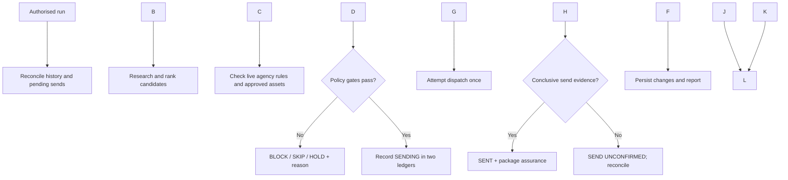

# Agentic Literary Fiction Submission Workflow

**Operational case study | Agentic workflow architecture, controls and evidence**

* **Problem:** Literary-agent submissions require recipient-specific research, compliant materials, duplicate prevention and reliable follow-up records.
* **Approach:** Combine AI-assisted prospect research with policy gates, controlled autonomy, structured records and human escalation.
* **Scope:** Private workflow with recorded submissions. This repository is a **sanitised design and evidence summary**, **not executable source code**.

## Recorded activity

|Private tracker snapshot · 6 Nov 2026|Count|
|-|-:|
|Candidates recorded|**167**|
|Agent-origin submissions marked `SENT`|**62**|
|Agent-origin sends marked `SEND UNCONFIRMED`|**4**|

*Counts are tracker states, not independently audited provider receipts or proof of recipient delivery.* [Evidence and definitions](evidence/EXECUTION_EVIDENCE.md).

## Workflow

## Design decisions

|Risk|Control|
|-|-|
|Duplicate or prohibited submission|Historical recipient/agency checks; current official guidelines|
|Unsupported claims or wrong materials|Locked assets, factual answer bank and preflight|
|Ambiguous send outcome|Dual pre-send writes; no blind resend|
|Overreach or runaway cost|Human escalation; capped attempts and research budget|

## Supporting documentation

|Document|What it demonstrates|
|-|-|
|[Operating Contract](docs/OPERATING_CONTRACT.md)|Authority, eligibility and stop conditions|
|[Execution Profile](docs/EXECUTION_PROFILE.md)|Ranking, daily run design and state handling|
|[Execution Evidence](evidence/EXECUTION_EVIDENCE.md)|Recorded activity and verification boundaries|

**Portfolio focus:** Process redesign, agentic orchestration, operational governance and evidence-led evaluation. Live account bindings, personal information and manuscript assets are deliberately excluded.

