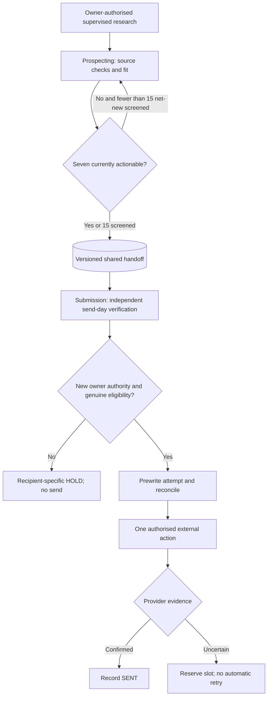

# Agentic Literary Fiction Submission Workflow

**Operational case study | Two-agent architecture, controlled execution and evidence**

*Public documentation updated 13 November 2026.*

The original single-agent submission automation has evolved into a **two-agent, evidence-led research and submission workflow**. Current private governing documents are Master v7.2, Prospecting v7.2 and Submission v7.2; this repository contains **sanitised design abstractions and an offline Python demonstration**, not live operational credentials or manuscript assets.

**Roles:** Prospecting researches and scores literary agents without sending rights. Submission independently checks agency instructions, historical contacts, approved author materials, owner authority and provider receipts before any outward action. The owner controls all actual transmission permissions. The handoff preserves separate **literary fit** and **preliminary submission readiness** labels.

### Standing model configuration and response handling

- **Prospecting model:** GPT-6 Sol — Medium. **Submission model:** GPT-6.1 Terra — High. These are owner-designated roles, not independently verified runtime claims.
- The owner established a standing intent for **one designated Submission Agent**, so neither role asks for routine model or concurrent-sender reconfirmation every supervised pass. This is **not** a live exclusivity attestation; current ledger conflicts must still be checked and unattended production requires technical enforcement.
- Submission reconciles verified incoming agency responses under an existing project Gmail label. Routine fully recorded acknowledgements may be archived; manuscript requests, representation offers and other priority messages stay in the Inbox for owner action. Prospecting has **no inbound response-processing authority**.

### Owner-approved research and packaging decisions

- **Finite-market research limit:** target **seven currently actionable prospects**, replenish when below seven, and screen at most **15 net-new** candidates in each separately authorised research run. An individual package hold or failed site does not automatically end the wider search.
- **Document equivalence:** match word-count guidance to the **nearest existing author-approved document of the same category**. Keep author text unchanged, preserve truthful declarations and respect actual portal enforcement.
- **Operational flexibility:** agency-specific attachment filenames are metadata-only; author-supplied biography and writing ambitions are matched by meaning, not rigid phrase matching. A strictly AI-free locked covering letter cannot be autonomously rewritten.
- **Safety boundaries unchanged:** independent send-day checks, idempotency, controlled retries, historical duplicate protection, owner authorisation and evidence-backed reporting.

### Evidence and deployment status

- The **12 November 2026** observed pilot recorded five provider-confirmed outward actions across three separately owner-authorised manual runs. Provider confirmation does not establish agent reading, interest or representation.
- The **initial 13 November** supervised Prospecting pass assessed five net-new and two historical leads, ending with **one currently actionable** candidate. This is a **pre-revision diagnostic**, not a measured success of the new 15/7 rules.
- The **revised 13 November** Prospecting rerun increased currently actionable inventory from **one to seven of seven**, releasing **four historical holds** and qualifying **two net-new** leads. The **15-net-new ceiling was respected**, although the exact number screened was not measured in the closing evidence.
- A separate **supervised Submission run** independently reviewed seven prospects and confirmed **five provider-side transmissions** (four Gmail Sent confirmations; one official-form success), with **zero new uncertain deliveries**. One prospect remained actionable but unsent at the daily ceiling and one was held after independent review. Three automated acknowledgements were reconciled; two were newly labelled and archived.
- A **configuration monitoring exception** occurred: the owner amended the private governance documents during the Submission run and the final send preceded the agent's change detection/reload. This is disclosed rather than represented as a perfect governance pass.
- **Neither agent is approved for unattended operation.** Standing model assignments eliminate repeated confirmation prompts but do **not** prove live runtime identity or a technical single-sender lease.
- The offline Python demonstration still contains **22 passing synthetic tests** of selected logic. It has **no Gmail, browser, Google Drive, external form, LLM or real sending integration**.

### Repository contents

- [Architecture and 30-column handoff](docs/TWO_AGENT_ARCHITECTURE.md)
- [Sanitised control contract](docs/PUBLIC_CONTROL_CONTRACT.md)
- [Prospecting public profile](docs/PROSPECTING_AGENT_PUBLIC_PROFILE.md)
- [Submission public profile](docs/SUBMISSION_AGENT_PUBLIC_PROFILE.md)
- [Research metrics and revised targets](docs/HANDOFF_SCHEMA_AND_METRICS.md)
- [13 November early-stop diagnostic](evidence/PROSPECTING_RUN_2026-11-13_BASELINE.md)
- [Verified supervised execution: 13 November](evidence/SUPERVISED_EXECUTION_2026-11-13.md)
- [Historical single-agent tracker baseline: 6 November](evidence/EXECUTION_EVIDENCE.md)
- [Reusable future-run evaluation template](evidence/POST_RERUN_EVALUATION_TEMPLATE.md)
- [Observed two-agent pilot: 12 November](evidence/TWO_AGENT_CASE_STUDY.md)
- [Autonomous-deployment evidence gates](docs/AUTONOMY_RELEASE_GATES.md)
- [Offline synthetic demonstration](demo/README.md) — standard-library Python; run `python -m unittest -v test_workflow.py` from `demo/`

> Previous results dated **6 November 2026** belong to the legacy single-agent baseline. They should not be added to the two-agent results. This public architecture describes owner-supervised operations and prospective controls, not a deployable unattended service.
